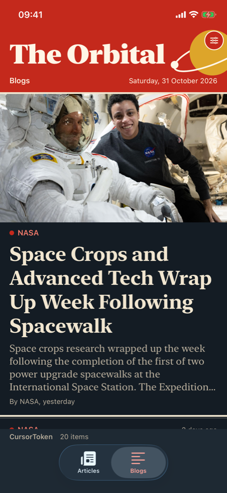
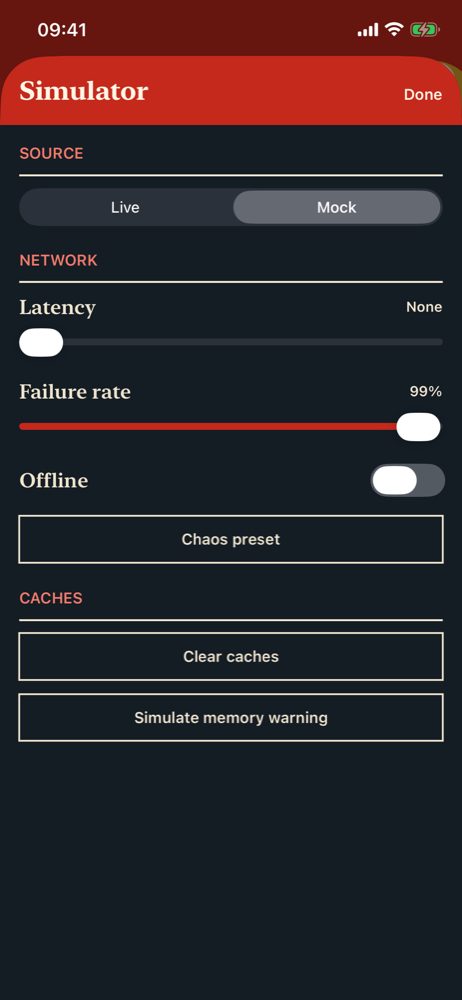
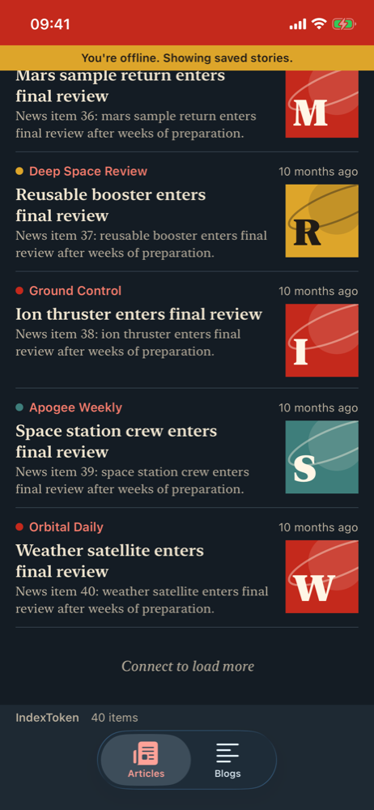
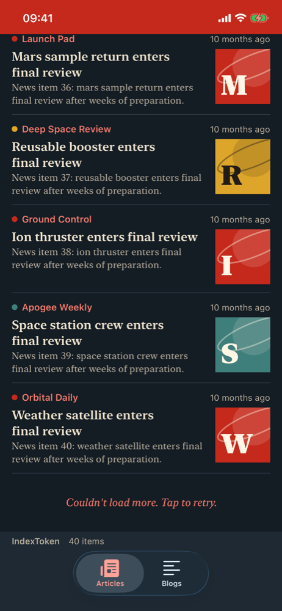
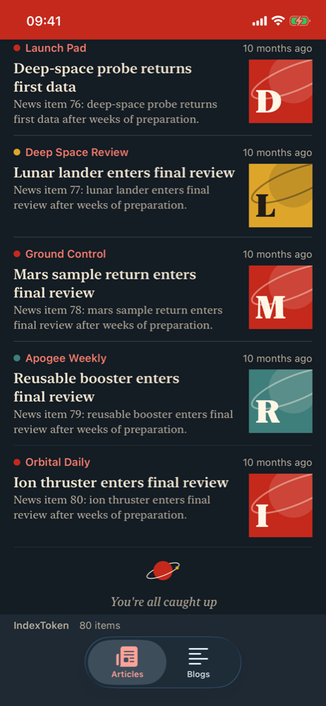

# PageKitDemo

**The Orbital** is a small spaceflight news app built to show
[PageKit](https://github.com/frankthamel/PageKit), a reusable Swift pagination library, working
on a real feed. It reads live news from the
[Spaceflight News API](https://api.spaceflightnewsapi.net), and can switch to a simulated network
that you can make slow, flaky or absent.

| Articles | Blogs | Simulator |
| --- | --- | --- |
|  |  |  |

## Getting started

You need Xcode 26.2 or later. The app targets iOS 26.2.

PageKit is a git submodule, so clone with `--recurse-submodules`:

```sh
git clone --recurse-submodules https://github.com/frankthamel/PageKitDemo.git
cd PageKitDemo
open PageKitWS.xcworkspace
```

If you already cloned without it, run `git submodule update --init`.

Always open `PageKitWS.xcworkspace`, not the project inside it. Pick the `PageKitDemo` scheme and
an iOS simulator, then run.

The submodule pins a specific PageKit commit, so the app builds against exactly that code. To
try a newer PageKit, update `Packages/PageKit` and commit the new pin.

**To run on a device,** change `DEVELOPMENT_TEAM` to your own team. The project carries the
author's team ID, which won't sign for you. Set it under Signing & Capabilities for each target.
Simulator builds don't need this.

## Modes

| Mode | How to start it | Where stories come from |
| --- | --- | --- |
| Live | The default | The Spaceflight News API. Needs a connection. |
| Mock | Launch with `-mock`, or use the Simulator panel | `MockNewsService`: 2,000 generated stories per feed, no network. |

To launch in mock mode from Xcode, add `-mock` under Product > Scheme > Edit Scheme > Run >
Arguments. You can also switch at any time in the panel. Switching releases both feeds, clears
PageKit's caches and builds the feeds again. Each mode caches under its own feed IDs, so live and
mock stories never mix.

## The Simulator panel

Tap the round slider button in the masthead.

| Control | What it does |
| --- | --- |
| Source | Switches between Live and Mock. |
| Latency | Delays each mock request by a random time, up to 3 seconds. |
| Failure rate | The chance that a mock request fails. |
| Offline | Makes every mock request fail as if there were no connection, and tells the feeds the network is down. Turning it off tells them it is back, and they resume by themselves. |
| Chaos preset | Sets a rough network: up to 3 seconds of delay and one failure in five. |
| Clear caches | Empties PageKit's memory and disk caches. |
| Simulate memory warning | Empties the memory cache only. Stories already on screen stay. |

The network controls only affect mock data, so they are disabled in live mode.

Scroll with Offline on and the feed stops at "Connect to load more". Raise the failure rate and it
stops at "Couldn't load more. Tap to retry."

| Offline | Failed page | End of feed |
| --- | --- | --- |
|  |  |  |

## Two feeds, two kinds of token

Both tabs share one view model and one set of views. Only the source differs, which is the point:
PageKit doesn't care how a server pages.

| Tab | Source | PageKit token | How the next page is found |
| --- | --- | --- | --- |
| Articles | `ArticlesIndexSource` | `IndexToken` | The app works out the next offset, and stops at the server's total. |
| Blogs | `BlogsCursorSource` | `CursorToken` | The server names the next page, and sends none on the last one. |

Both load 20 stories a page. The small print above the tab bar shows the token type and how many
items are loaded, so you can watch pagination happen as you scroll.

## Architecture

```
PageKitDemoApp
  └─ AppEnvironment                 composition root: picks live or mock
       ├─ NewsService
       │    ├─ LiveNewsService      NewsClientLive: URLSession and the real API
       │    └─ MockNewsService      NewsClient: simulated network
       ├─ SimulatedConnectivity     mock mode's network status
       └─ Feeds
            ├─ FeedViewModel<ArticlesIndexSource>
            └─ FeedViewModel<BlogsCursorSource>
                 └─ Paginator       PageKit: state, caching, prefetch, retries

FeedScreen  draws one snapshot from the view model, and reports which rows appear
SimulatorPanel → SimulatorViewModel → MockNewsService, SimulatedConnectivity
```

| Folder | Holds |
| --- | --- |
| `PageKitDemo/PageKitDemo/App` | The app entry and `AppEnvironment`. |
| `PageKitDemo/PageKitDemo/Sources` | The two `PageSource`s. |
| `PageKitDemo/PageKitDemo/Features` | The feed and simulator screens. |
| `PageKitDemo/PageKitDemo/DesignSystem` | Colours, type and shared components. |
| `Packages/NewsClient` | The news models, the service interface, and the live and mock services. |
| `Packages/PageKit` | The library, as a submodule. |

`NewsClient` knows nothing about PageKit. The app's sources are the only place the two meet.

## Tests

```sh
# Unit tests
xcodebuild test -workspace PageKitWS.xcworkspace -scheme PageKitDemo \
  -destination 'platform=iOS Simulator,name=iPhone 16e' -only-testing:PageKitDemoTests

# UI tests
xcodebuild test -workspace PageKitWS.xcworkspace -scheme PageKitDemo \
  -destination 'platform=iOS Simulator,name=iPhone 16e' -only-testing:PageKitDemoUITests

# The news client
cd Packages/NewsClient && swift test
```

The UI tests use `-mock`, except `testLiveFeedScrollPerformance`, which needs the network and
skips itself if the feed can't load.

### Scroll performance

`testScrollPerformance` and `testLiveFeedScrollPerformance` record `XCTOSSignpostMetric` scroll
metrics. On a simulator these report only how long scrolling took, not hitches, so judge hitches
on a device. Any hitch baseline should be recorded on a device, locally. It isn't enforced in CI,
because hosted runners are too noisy.

### Known limitation: images

Rows use `AsyncImage`, which decodes full-size images. A frame-timing probe on an iPhone 16e
simulator measured about 81 ms of hitches per second of scrolling on the live feed, with single
stalls over a second. The same feed without images measured about 12 ms/s. A simulator is not a
device, so treat these as a comparison, not as real-world numbers. They do show images are the
main cost.
